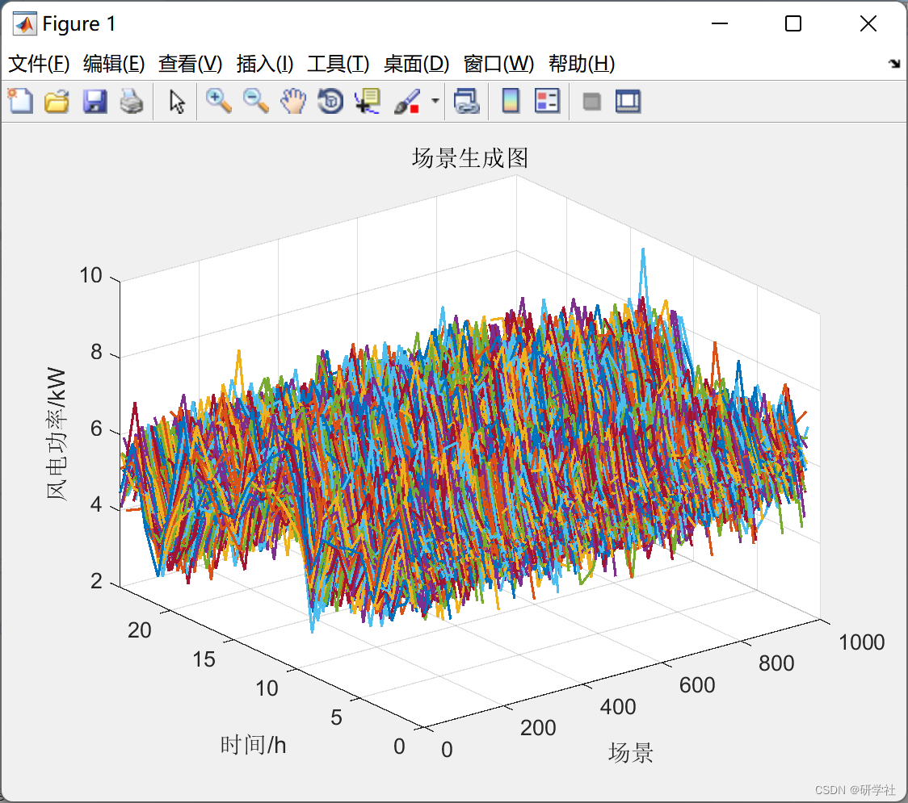
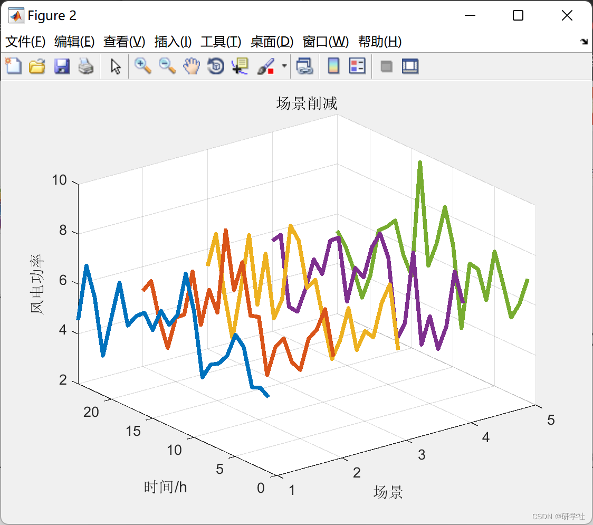
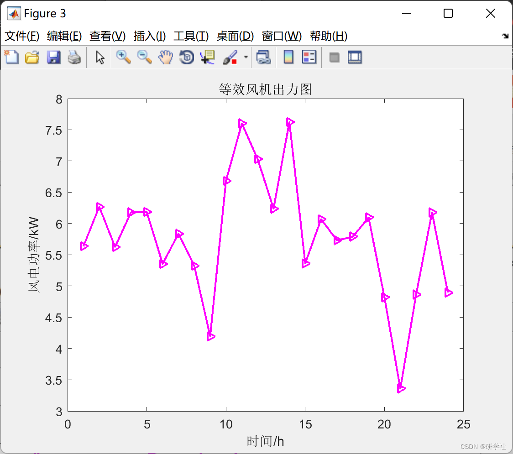
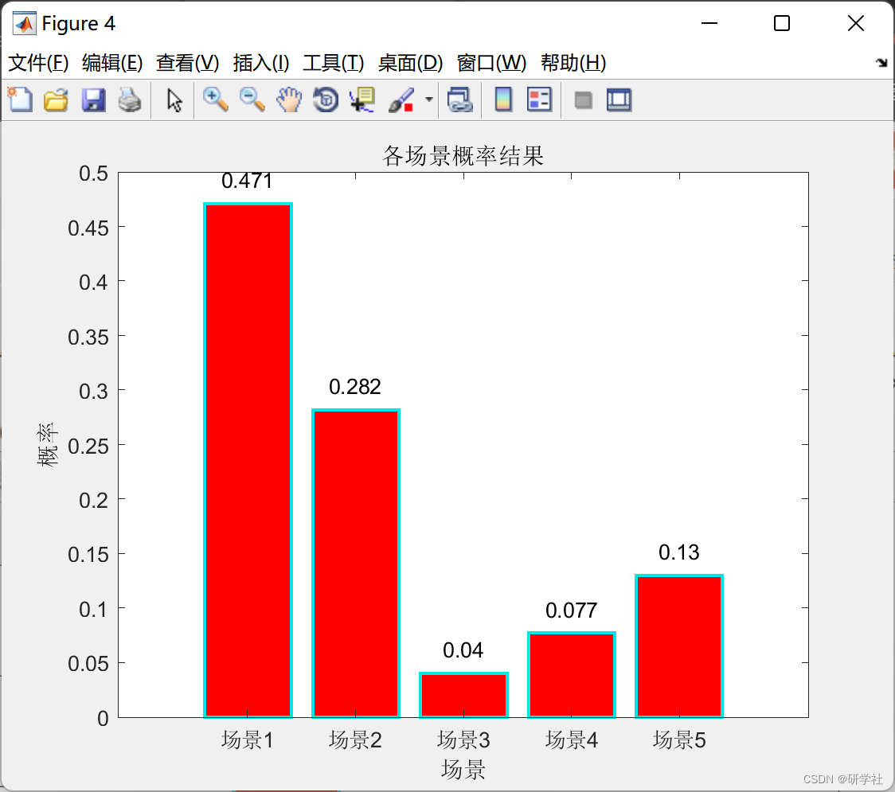
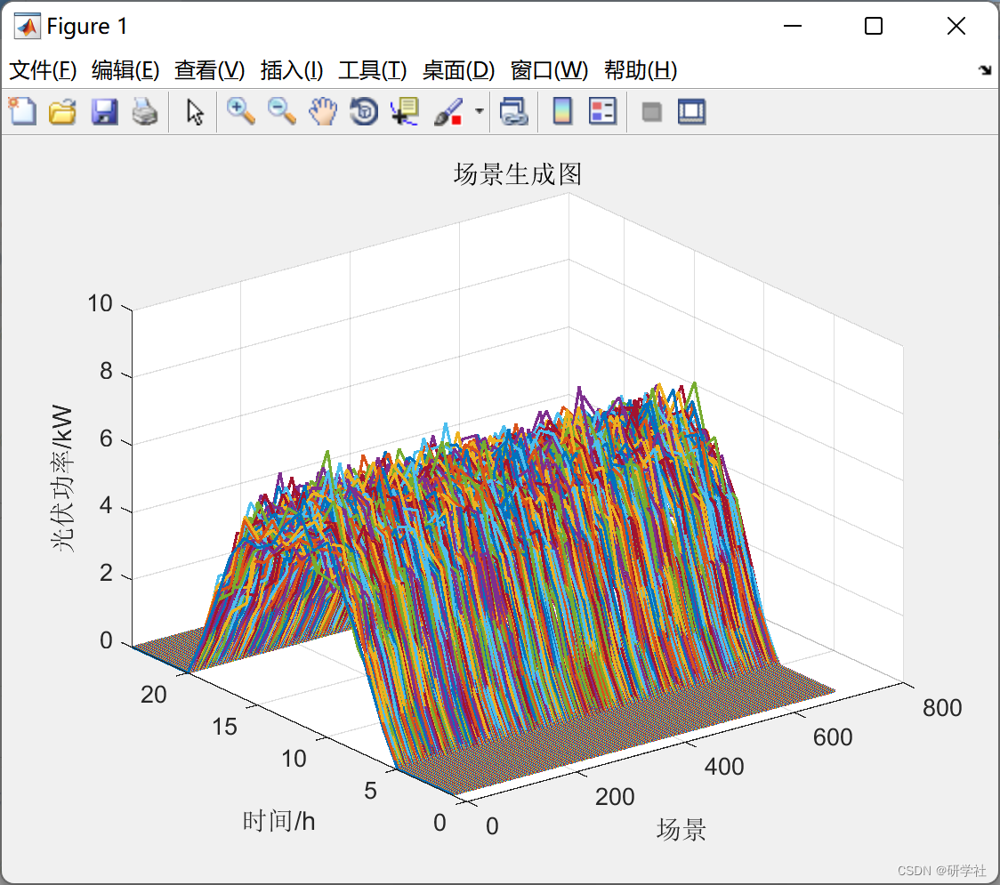
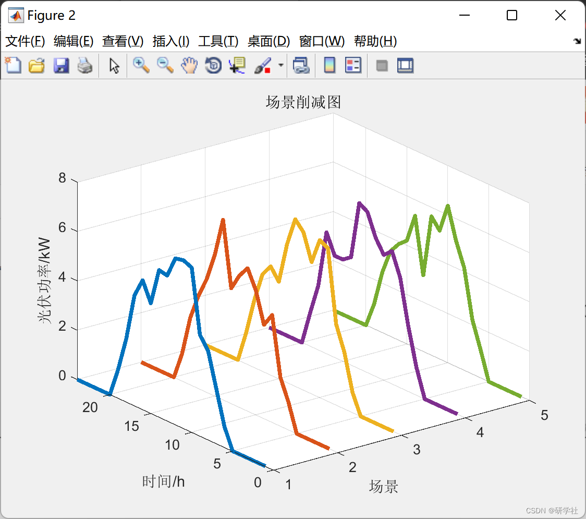
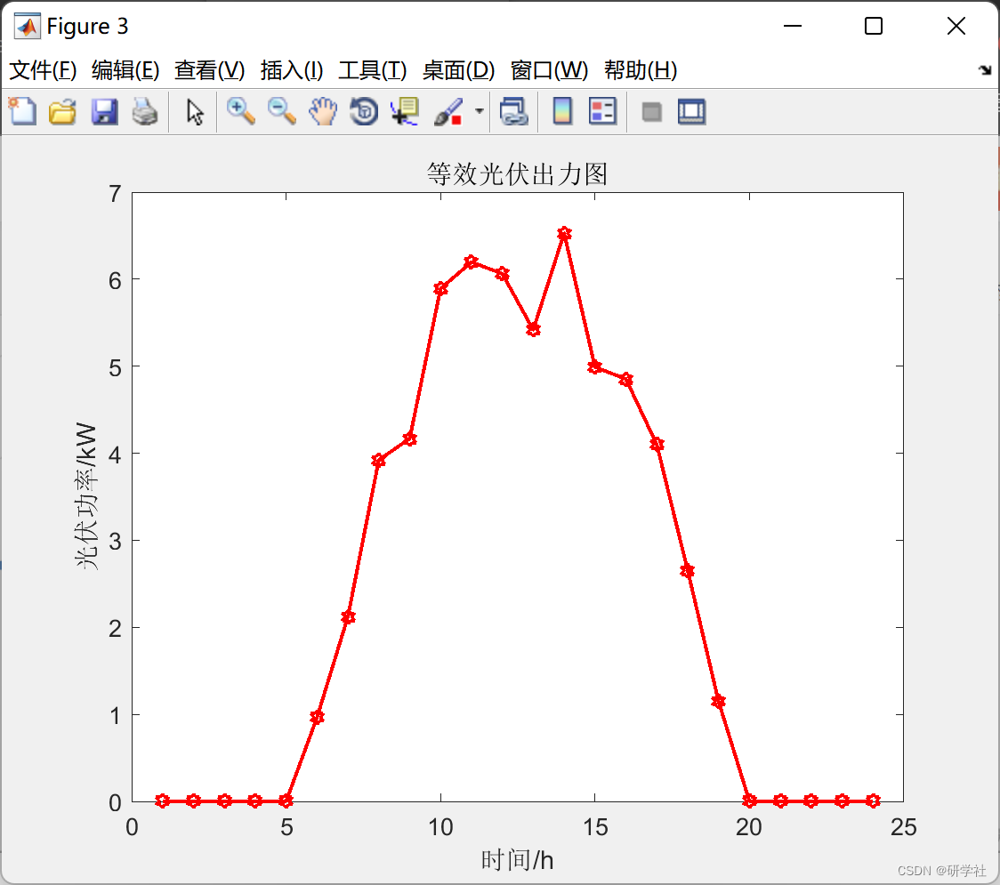
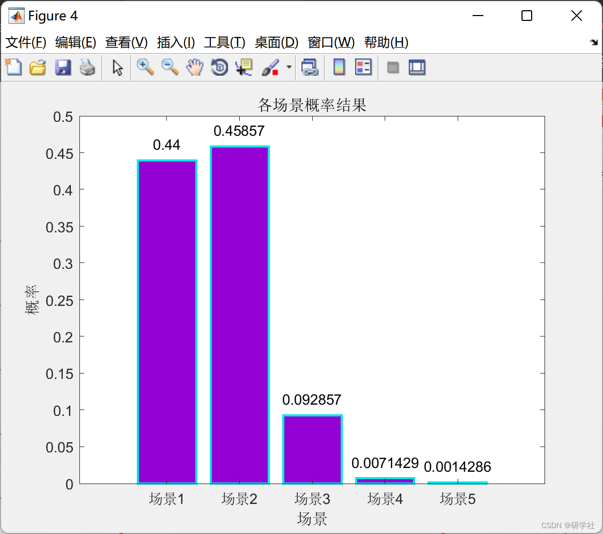

# Uncertainty Reduction of Wind and Light Scene Based on Probability Distance Reduction Method and Monte Carlo Reduction Method (Matlab Code Implementation)

💥💥💞💞 Welcome to this blog❤️❤️ 💥💥
🏆 Bloggers' Advantages: 🌞🌞🌞 The content of the blog strives for rigorous thinking and clear logic, making it convenient for readers.
⛳️ Mantra: A journey of a thousand miles is begun with a single step. 1 Overview📚 2 Run-time Results 2.1 Wind Power Scenario Reduction 2.2 Photovoltaic Scenario Reduction🎉 3 References 🌈 4 MATLAB Code Realization
💥1 Overview  Represented by wind and photovoltaic energy, renewable power generation has characteristics of randomness, intermittency, and volatility. In future high proportions of renewable energy power systems, its large-scale grid connection will bring challenges to the safe and stable operation of the power grid. To study optimization issues such as power system planning, operation, and dispatching under high proportions of renewable energy, it is first necessary to accurately characterize the randomness and volatility of wind and photovoltaic outputs, and solve the problem of high time complexity caused by large-scale time series data, therefore, it is necessary to reduce the wind and photovoltaic output scenarios to achieve the purpose of simplifying data and reducing computational load. The output of wind and photovoltaic power varies with time and shows certain seasonal or daily periodicity. Therefore, scene analysis can be conducted on the output of wind and photovoltaic power, transforming uncertainty into deterministic scenes, providing data foundation for subsequent optimization problems in power system planning, operation, and dispatching.
Currently, there are three types of scenario analysis methods: Time Series Simulation Method, Typical Day Method, and Scenario Clustering Method. The Time Series Simulation Method, as documented in literature, uses Monte Carlo method considering the characteristics of wind power processing, simulating the annual wind and load time series scenarios. The Typical Day Method takes the characteristic of one day's output as a typical scenario, as documented in literature, using the day with the largest peak-to-valley difference in annual load as a typical day for annual electricity balance calculation, which obviously cannot reflect the output characteristics of wind power. The Scenario Clustering Method clusters curves with similar degrees of similarity into one category, for example, as documented in literature, K-means is used to cluster annual wind, photovoltaic, and load data for medium and long-term planning in power systems. Currently, the most commonly used method is the Scenario Clustering Method, as its results can accurately reflect the features of scenarios and have higher computational efficiency.
📚2 Run-time Results 2.1 Wind Power Scenario Reduction​Edit
Editor
Editor
2.2 Photovoltaic Scenario Reduction Edit
Editor
Editor
Editor
Outlook and Reflections:
As the contradiction between energy demand growth and the exhaustion of fossil fuel resources becomes increasingly prominent, the large-scale development of low-carbon and clean new energy is one of the important measures for China to achieve energy transition and address global climate change. However, the inherent uncertainties of wind and solar power pose significant challenges to the stable operation of the power system. The inability of the power system to absorb these energies has led to severe issues of wind and solar power curtailment. Therefore, researching methods for power system power source planning under the circumstances of large-scale integration of new energy sources is of great significance. To fundamentally solve this issue, it is necessary to consider both the uncertainty of wind and solar power during the planning stage and the operational conditions of the power system. On one hand, it is essential to accurately describe the actual distribution characteristics of wind and solar power, and on the other hand, it is necessary to provide multi-energy power system power source planning schemes that can efficiently and accurately simulate the grid connection operation of various sources.
Utilizing renewable energy for power generation, distributed power sources have rapidly developed in recent years due to their advantages of pollution reduction, high efficiency, and cost savings in transmission and transformation investments. However, the characteristics of small capacity, large number, and dispersed nature of distributed power sources also lead to high costs for individual unit connection to the grid and management difficulties. The microgrid 2 and are proposed solutions to the problem of virtual grid integration. The two methods involve packaging multiple small power sources together and integrating output management to manage various distributed power sources, thereby stabilizing a larger output force. Compared to microgrids, virtual power plants focus more on top-down management and control, presenting a more traditional power plant appearance from an external perspective. To ensure the operation of the virtual power plant, it can sign V-shaped agreements. In fact, on one hand, renewable energy generation has uncertainties in output power, and on the other hand, there are dispatch rules that favor renewable energy generation, and even the absorption rate of renewable energy generation is an important indicator for the operational performance of the power grid. Therefore, between distribution companies and virtual power plants, effective cooperation can be achieved through reasonable arrangements such as scheduling hydropower output periods and wind curtailment volumes, reducing uncertainty impact on grid integration, reducing distribution companies' purchase costs, increasing virtual power plants' revenue, and guiding renewable energy generation to improve prediction accuracy. Therefore, the feasibility of cooperation between virtual power plants and distribution companies is analyzed, and three models are constructed based on scenario analysis methods: single virtual power plant dispatch, collaborative dispatch among multiple virtual power plants, and joint optimization between virtual power plants and distribution companies. Based on cooperative game theory, the space for cooperation and the allocation scheme of benefits between virtual power plants/distribution companies are quantitatively analyzed. 🎉3 References  
[2] Dong Wenlu, Wang Qun, Yang Li. Coordinated Dispatch Model of Virtual Power Plants with Wind and Solar Energy and Distribution Companies [J]. Electric Power System Automation, 2015, 39(09): 75-81+207.  
🌈4 MATLAB Code Realization

## Images

<!-- PAYMENT_BLOCK -->

## Get this dataset

- Payment link (Stripe): [Buy now](https://buy.stripe.com/3cs8yP7sY87d0vu9AB)
- Payment QR code: 

<!-- /PAYMENT_BLOCK -->
